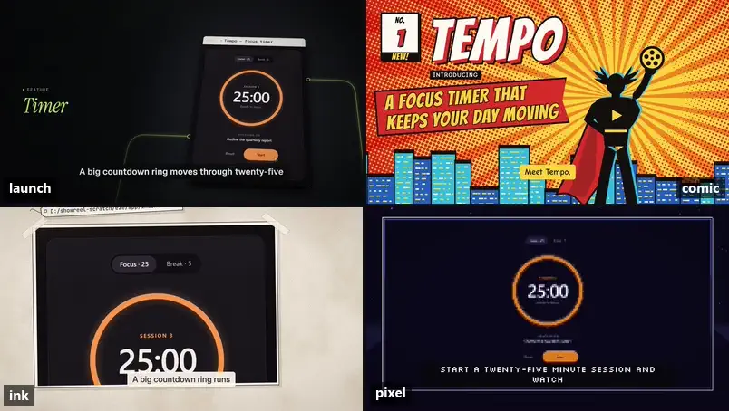
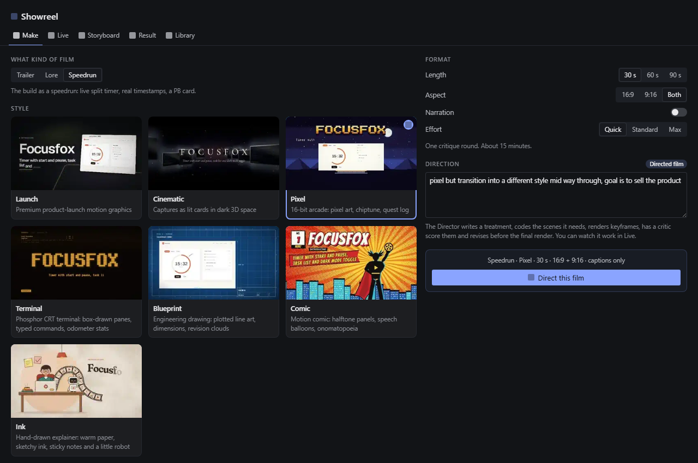
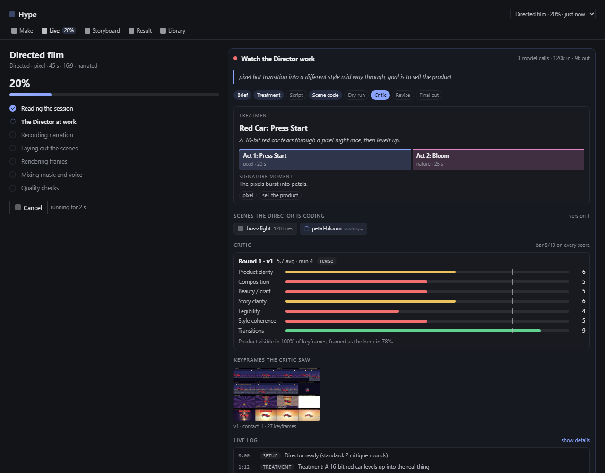
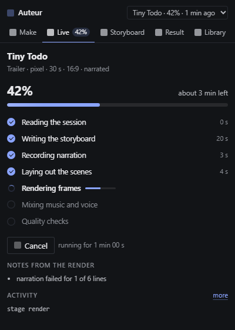

# Hype

**An engine inside a Hermes plugin: type `/hype` and the session you just worked in becomes a launch
trailer for the thing you built.** Music and on-screen type by default; a narrator when you ask for one.



*One session, four presets. Tempo is a focus timer that Hermes built in one real chat; these are 3.6 seconds
from each of four 30 s films that the installed plugin made from that chat (`launch`, `comic`, `ink`, `pixel`),
with no prompting: the session was the brief. Rendered locally by Hype's own pipeline: HTML scenes in headless
Chromium, original music and SFX, ffmpeg.*

[](https://github.com/asdugit/hermes-hype/actions/workflows/ci.yml)
License: AGPL-3.0-or-later · Hermes Agent >= 0.22.5 · Windows, macOS, Linux

## Why it's different

- **Zero prompting.** `/hype` reads the session itself: what you asked for, the files that were written, the
  diffs, the terminal output, the passing tests, the screenshots, the app it built. You don't explain the project
  or paste anything into another AI. The product is the hero (about 70 %); the session is the proof (real diffs,
  real terminal, real numbers, about 30 %). Nothing on screen is made up: code, commands, output and stats are
  verbatim from the session, and the model only picks, orders and narrates them.
- **Presets that are fully customizable.** Seven polished styles, three kinds of film (trailer, lore,
  speedrun), 30/60/90 s, 16:9 or 9:16. Change any preset's colours, fonts, music, energy, voice and words by just
  saying so.
- **A free-roam engine.** Don't want presets? Write a direction in plain words and the Director engine writes a
  treatment, codes the scenes it needs, renders keyframes, has a vision critic score them, and revises before the
  final render. Kits, proven blueprints, schema repair and measured gates carry the craft; smaller models get a
  simpler compose path (pick a blueprint, write the words, the engine assembles and checks the film). Measured:
  a small model lands about one point below a frontier model, at a fraction of the cost
  ([Any model](#any-model-measured)).

## Quick start

```bash
hermes plugins install asdugit/hermes-hype
hermes plugins enable hype        # if the installer did not enable it
```

Then, in any chat where you built something:

```text
/hype                       a 60 s launch trailer of what this session built (launch style, 16:9)
/hype lore                  the making-of: the build story is the hero (aliases: bts, process, making-of)
/hype speedrun              the build as a speedrun: live split timer, real timestamps, a PB card
/hype pixel 30 vertical     any style, length and aspect, in any order
/hype comic 90 both mute    16:9 and 9:16 from one storyboard, captions only
```

Arguments are free-order: `[lore|speedrun] [style] [30|60|90] [vertical|both] [mute] [blender]`.
A preset film takes a few minutes: 30 s films took about 4-8 minutes in our end-to-end runs, on a laptop busy
with other renders. In Desktop and the TUI the command answers at once and the
film renders in the background, with progress in the chat. In CLI and messaging sessions it waits and then
sends the video.

`/hype styles`, `/hype status`, `/hype cancel` and `/hype help` do what they say.
`/hype revise <notes>` makes a new cut with your notes.

## Presets

| Style | Look |
|---|---|
| `launch` (default) | Premium product-launch motion graphics: graphite stage, UI panels on a lit table, one accent colour |
| `cinematic` | Captures become lit cards in dark 3D space; letterbox, serif titles, a slow camera with weight |
| `pixel` | 16-bit arcade: pixel art, chiptune, quest log, the product as a boss or an item-get |
| `terminal` | Phosphor CRT: box-drawn panes, typed commands, odometer stats, scanlines |
| `blueprint` | Engineering drawing: plotted line art, dimension lines, revision clouds for diffs |
| `comic` | Motion comic: halftone panels, speech balloons, onomatopoeia |
| `ink` | Hand-drawn explainer: warm paper, sketchy ink, sticky notes and a little robot |

Every style has its own original music beds and sound effects, and works in all three kinds of film:
**trailer** (default: the product), **lore** (the making-of) and **speedrun** (the build against the clock).
Lengths: 30, 60 or 90 s (anything from 15 to 180 works). Aspects: 16:9, 9:16 or both (1:1 is experimental).

### Customize any preset

Presets are a starting point, not a cage. Say what you want after the style, or set a knob directly:

```text
/hype launch pink and playful with a punchier ending
/hype terminal green phosphor hacker vibe, faster
/hype cinematic accent=#ff4f8b title="Tally" tagline="Your bank CSV, finally readable"
/hype pixel 30 energy=high music=pixel_boss cta="Try it today"
/hype ink language=es voice=warm logo=~/brand/logo.png
```

- **Knobs** (`key=value`) are exact and need no model: accent, palette, background and text colours, font,
  music, energy, narration, voice and pace, title, tagline, call to action, product name, logo, captions,
  transitions, length, aspect and language. Unknown keys get a friendly list of the valid ones.
- **Plain words** after a preset are read by a keyword reader (no model) and one small model call over the
  preset's own film, validated and repaired before anything changes: palette, words, music, pacing, shot order and
  holds. Facts (code, stats, terminal output) are never rewritten, and a weak model or no model still gives a
  customized film.
- **Routing.** A preset plus words customizes that preset. Words without a preset make a Directed film. A preset
  plus something it can't do (another style midway, new scenes, "free roam") goes to the Director, starting from
  that preset.
- The same works in the Desktop studio (Customize preset, with a knobs row), the tool (`customize`, `knobs`) and
  the CLI (`--customize`, `--set KEY=VALUE`). Defaults for every film: the `customize` setting.

Every knob, what it accepts and how the free text is read: [docs/CUSTOMIZE.md](docs/CUSTOMIZE.md).

## Don't want presets? Here's the engine

Free text without a preset (or asking a preset for something it can't do) is a **direction**, and the film
becomes a **Directed** film:

```text
/hype pixel but transition into a different style mid way through, goal is to sell the product
/hype a noir detective story where the bug is the culprit and the test suite cracks the case
```

The Director engine runs a production pipeline with your Hermes model:

1. **Treatment**: logline, acts, a style per act, the signature moment, the music plan.
2. **Film script**: shots, transitions, overlays and cues, validated against a typed schema.
3. **Scene code**: where the built-in kits lack a scene, the model writes one against Hype's scene SDK.
   Generated scenes are linted (no network, no timers, no randomness), dry-run in Chromium and probed for
   determinism before anything is rendered.
4. **Critic**: keyframes go onto contact sheets, and a vision critic scores product clarity, composition, craft,
   story, legibility, style coherence and transitions against an 8/10 bar. It also measures how much of the
   film shows the product.
5. **Revise** until the bar is met or the round budget (`effort`: quick, standard or max) runs out; the best
   version wins.
6. **Final cut**: render, music fitted to the cut, narration, mix, and the same video and audio quality gates
   as presets.

You can watch all of it live in the Desktop studio. Scenes that pass the critic are saved to your library
(`plugin-data/hype/library/`) and can be reused by name in later films ("use my boss-battle scene").
If the Director fails, you still get a preset film in the style you asked for.

Directed films cost real model usage. In our trials with a frontier model, a standard-effort film took about
25 minutes and about US$7 of model usage, and a quick one about 14 minutes and US$3. Presets make a few model
calls per film.

### Any model (measured)

The Director picks a path from the model it gets. Strong models take the free path (treatment, script, custom
scene code, vision critique, revisions). Small models (Haiku, Flash, mini and local models) take the compose path:
two small schema-checked calls pick a proven blueprint and write the words, and the engine assembles, repairs,
grades and checks the film. Without vision, a measured review (product size and visibility, layout, frozen or flat
frames, pacing) replaces the critic.

Our trials: same product, same direction, 30 s films. Noir scores are from the same strong vision critic on
its 10-point scale (the bar is 8); keynote scores are our own review by eye, because the frontier model's critique
was skipped in that run (no like-for-like critic score; the critic gave Haiku's keynote 5.4).

| Direction | Model and path | Score | Model cost |
|---|---|---|---|
| "a noir detective trailer" | frontier model (`claude-fable-5-2`), free path, 2 custom scenes, 2 critic rounds | 6.7 | US$12.97 |
| | Claude Haiku 4.5, compose path | 5.7 | US$0.88 (US$0.64 of it the strong critic) |
| | DeepSeek V4.1 Flash, compose path, no vision | 5.7 | US$0.01 (+ US$0.29 for the critic's score) |
| "an Apple keynote reveal" | frontier model, kit and Blender scenes | about 7 (by eye) | US$1.38 |
| | Claude Haiku 4.5, compose path | about 6.5 (by eye) | US$0.45 |

The honest reading: small models land **about one point below** the frontier model, for a fraction of the cost
and time (in our dev runs Haiku's noir took 13 minutes, the frontier model's 93). The gap is in ideas, not
polish: all three noir films are clean, legible and on-brand, with the product in every product shot, but only
the strong model invented new scenes (a case board that turns into an orbit); the small models re-dressed a proven
blueprint with noir words. Small models' revisions made films worse, so they get one critique and the best
version wins. The two keynote films, Haiku and the frontier model on the same product and direction, play side by
side in the demo video.

### Blender (optional 3D engine)

3D shots render in headless Chromium (three.js) by default. Add `blender` to the command
(`/hype cinematic 60 blender`), say "use blender" in a direction, or set `engine_3d: blender` (or `auto`) to
render them with **your own installed Blender 4.2+**: real 3D products, smooth spline cameras, motion blur.

- Hype runs your Blender as a headless subprocess with `--factory-startup` (your preferences and add-ons are
  not loaded or changed), on a job file in the film's job folder, and composes the frames with the rest of the
  film. Cancelling stops only the Blender process Hype started.
- Blender is found through `HYPE_BLENDER`, the `blender_path` setting, `PATH`, then the usual per-user and
  system install folders (the same ones the official Hermes `blender` plugin uses when its skill installs
  Blender). Without it, the film falls back to the browser engine and the job log says so.
- **No Blender yet?** Hype can install it for you, but only when you say yes: `hermes hype install-blender`,
  the y/N question `hermes hype doctor` asks at a terminal, or **Install** in the Desktop studio when you pick
  the Blender engine. It downloads the official Blender 5.2.4 LTS (4.5.9 LTS on Intel Macs, which Blender 5
  no longer supports; about 270-410 MB) from `download.blender.org`, checks the SHA-256 pinned in
  `showreel_core/blender/install.py` and refuses the file on a mismatch, and unpacks it for your user only, no
  admin rights: `%LOCALAPPDATA%\Programs\Blender Foundation\Blender 5.2` on Windows, `~/Applications/Blender
  5.2.app` on macOS, `~/.local/opt/blender-5.2.4` on Linux. It never writes over an existing folder, unpacks into
  a temporary folder next to the target and moves it into place in one step, and checks `blender --version`
  before it counts. `--dir PATH` installs somewhere else. CI, cron, the gateway, `--json` and any non-terminal
  run never get the question; chat (`/hype ... blender`) never asks either, it points at the command and renders
  with the browser engine.
- Blender is slower (about 0.5-1 s per 1080p frame with EEVEE on a desktop GPU). Hype times 3 frames first
  and shows the estimate, and caches rendered shots so a revision re-renders only what changed.

## Desktop studio

In Hermes Desktop, Hype adds a **studio** as a right-side pane and as a full page (sidebar: Hype),
command-palette entries ("Hype: make a trailer of this chat", lore, speedrun, open the studio), a status-bar
chip with live progress, and a Hype card around the video player when the agent's `hype_render` tool
returns a film.







*These screenshots are the real `desktop/plugin.js` rendered by our test harness (`tests/desktop`: React in
jsdom against a stub of the Desktop SDK, sample data, an approximate dark theme), not captures of the installed
app. Icons show as plain squares because the harness has no icon font. The style previews and the Director
contact sheet are real Hype output.*

Tabs: **Make** (kind, style gallery, format, then *Customize this preset* with a knobs row or *Free roam* for a
direction) · **Live** (stages, ETA, cancel, the Director at work) ·
**Storyboard** (edit titles and narration, drop or reorder scenes, re-render without a model call) · **Result**
(player, reveal file, render the other aspect, copy post text, revise) · **Library** (saved Director scenes).

## Agent tool and CLI

The agent gets two tools and a bundled skill that tells it when to use them:

- `hype_render`: makes a film (`mode`, `style`, `seconds`, `aspect`, `voice`, `customize`, `knobs`,
  `direction`, a `product` brief, `preview`, `engine_3d`). It waits up to about 4.5 minutes, then returns
  `MEDIA:<path>`; longer renders keep going and return a `job_id`.
- `hype_status`: a job's progress or result, or the list of styles.

So "make a 30 second vertical promo of what we built" works in plain chat. From a shell:

```bash
hermes hype render --session latest --style terminal --seconds 60 --aspect both
hermes hype render --style terminal --customize "green phosphor, faster" --set accent=#00ff66
hermes hype render --direction "a heist film where the tests are the vault" --effort quick
hermes hype styles
hermes hype doctor          # checks Chromium, ffmpeg, Blender (optional), assets and the runtime
hermes hype status
```

## Settings

Desktop → Capabilities → Plugins → Hype, or `plugins.entries.hype.settings` in `config.yaml`:

| Setting | Default | Meaning |
|---|---|---|
| `default_style` | `launch` | Style when the command names none |
| `default_seconds` | `60` | Length (15-180) |
| `aspect` | `16:9` | `16:9`, `9:16`, `both` or `1:1` (experimental) |
| `narration` | off | Off = music and on-screen type, nothing is sent to your TTS provider. On = a narrator (per film: `narrated`, `--narrate`, `narration=on`, or "with narration" in a direction) |
| `narration_speed` | empty | Empty = each style's pace (cinematic 1.13, others 1.0) |
| `redact` | on | Redact secrets, emails and home paths before the model and the render |
| `effort` | `standard` | Directed films: quick, standard or max critique rounds |
| `max_parallel_workers` | `0` | Render workers; 0 = automatic from free RAM |
| `engine_3d` | `browser` | `browser`, `blender` or `auto` |
| `blender_path` | empty | Path to Blender; empty = auto-detect |
| `customize` | empty | Default knobs for every preset film, e.g. `accent=#ff4fa3 energy=high` (lowest priority) |

The storyboard uses the auxiliary task `hype` (Hermes `auxiliary` settings), so you can point it at a
cheaper model than your main one.

## Requirements

| | Windows | macOS | Linux |
|---|---|---|---|
| Hermes Agent | >= 0.22.5 | >= 0.22.5 | >= 0.22.5 |
| Chromium | Hermes-managed (`hermes pm install chromium`) or installed Chrome / Edge / Chromium | same | same |
| ffmpeg | Hermes-managed (`hermes pm install ffmpeg`), `HYPE_FFMPEG`, or on `PATH` | same (ffprobe not needed) | same |
| Narration | your Hermes TTS (`text_to_speech`; Edge by default) | same | same |
| Blender (optional) | 4.2+, or install it with the official Hermes `blender` plugin | same | same |

No Python packages beyond what Hermes already ships (zero declared dependencies). About 0.5-0.7 GB of RAM per
render worker. A GPU helps but isn't needed: Chromium falls back to software rendering.

## Privacy and what the plugin does on your machine

Read this before installing. Hype:

- **Reads your session.** It reads the Hermes session it films from the session database (`state.db`),
  **read-only**: your prompts, the agent's messages, tool calls, terminal commands and output, file writes and
  diffs, screenshots and images. That is the chat you are in by default; the CLI and tool can name another
  session. Screenshots and images the session made are copied into the job folder.
- **Reads your project, to film the product.** It opens the product the session built (HTML files it wrote, and
  `localhost`/`127.0.0.1` URLs that appear in the session) in its own headless Chromium and takes screenshots,
  and it reads media and 3D model files the session produced. It never starts servers or runs project commands,
  and it doesn't open public URLs during capture.
- **Reads two sections of `config.yaml`, read-only:** `tts` (to warn when your TTS settings override the
  narration pace) and `plugins.entries.hype` (its own settings, for the Desktop studio).
- **Sends text to your model.** A redacted digest of the session (secrets, key-shaped tokens, emails and home
  paths removed; `redact` setting) goes to the model you use in Hermes through Hermes' plugin LLM API, as the
  auxiliary task `hype`. Directed films make many calls and also send keyframe contact sheets (images) to
  that model for the critic. This uses your provider account and costs what your provider charges.
  Redaction is best effort and does not touch pixels: screenshots in the film are shown as they were. Review the
  storyboard and drop scenes before you post.
- **Sends narration text to your TTS provider** only when you ask for narration, through Hermes'
  `text_to_speech` (Edge, the default, is a Microsoft online service). The default (music only) sends nothing.
- **Runs subprocesses:** headless Chromium, ffmpeg and, only when you ask for it, your Blender. After a yes to an
  install offer also `blender --version`, `hdiutil`/`ditto` (macOS .dmg) or `hermes pm install`. All with fixed
  argument lists. During a render it also serves the job folder to its own Chromium from a local web server on
  `127.0.0.1` with a random port and path; render pages can't reach the network.
- **Runs in the background.** Films render in background threads (one heavy render at a time) and can take
  minutes; Directed films can take 15-30 minutes. Cancel from the studio or with `/hype cancel`. Unloading the
  plugin stops its renders.
- **Writes** job folders under `<HERMES_HOME>/plugin-data/hype/jobs/`, saved Director scenes under
  `plugin-data/hype/library/`, and finished videos to `<HERMES_HOME>/cache/generated/videos/`.
- **Downloads Blender only when you answer yes.** `hermes hype install-blender`, the doctor's y/N question
  (interactive terminals only, default No, 60 s timeout = No) or the Desktop studio's Install button download
  Blender 5.2.4 LTS (4.5.9 LTS on Intel Macs) from `download.blender.org`, verify the pinned SHA-256 and install
  it per-user without admin rights (see "Blender (optional 3D engine)"). The doctor can also offer to run Hermes' own
  `hermes pm install ffmpeg|chromium` when those are missing. Nothing is downloaded otherwise.
- **Does not:** send telemetry, update itself, download anything else (fonts, music, three.js and Rough.js ship
  in the repo), read credentials, or need any API key.
- The package also contains developer harnesses (`python -m showreel_core.pipeline`, `...story.try`,
  `...director.try`) that can call `hermes chat` as a subprocess. The plugin's command, tools, CLI and Desktop
  studio never run them.

## Troubleshooting

- **"No Chromium found"**: `hermes pm install chromium`, or set `HYPE_CHROMIUM` to a Chrome/Edge/Chromium
  executable. `hermes hype doctor` shows what was found.
- **"ffmpeg not found"**: `hermes pm install ffmpeg`, or set `HYPE_FFMPEG`.
- **Blender not found** (only for the `blender` 3D engine): `hermes hype install-blender`, or set `HYPE_BLENDER`.
  Run at a terminal, `hermes hype doctor` offers these installs as y/N questions (`--no-prompt` to only report).
- **Captions but no voice**: your TTS provider failed (the job log says which line). With Edge, an outdated
  `edge-tts` package can get HTTP 403 from Microsoft; update Hermes. If narration plays at the wrong pace, remove
  `tts.<provider>.speed` from `config.yaml` (it overrides per-call speed; the job log warns about it).
- **The studio says "The Hype backend is not running"**: enable the plugin for the agent too
  (`hermes plugins enable hype`), then restart Hermes.
- **A Directed film fell back to a preset**: the Director hit an error or its budget; the job log says why.
  Try the `quick` effort (`/hype ... quick` or the `effort` setting), a shorter direction, a stronger model,
  or customize a preset instead.
- **Slow renders**: use `preview` (540p) for a first look, lower `max_parallel_workers` if RAM is tight, and keep
  Blender for when you want it.
- **Blender not found**: set `blender_path` or `HYPE_BLENDER`; Blender 4.2 or newer is required.

## Development

```bash
python -m pytest -q                 # fast suite; slow real-Chromium tests: --runslow
cd tests/desktop && npm ci          # enables the Desktop render check (node >= 22.22)
hermes plugins validate . && hermes plugins doctor --ci .
```

CI runs the fast suite on Windows, macOS and Linux, and `hermes plugins validate --install-deps` against a
pinned Hermes release. Architecture and contracts: `showreel_core/contracts.py`; kits: `kits/<style>/KIT.md`;
Blender scene modules: `blender_kits/`.

## Credits

- Code: © 2026 asdugit and the Hype contributors, AGPL-3.0-or-later (`LICENSE`).
- Music and sound effects: original, procedurally composed by this repository's own code (`tools/compose`); no
  samples, recordings or AI-generated audio (`assets/audio/LICENSE.md`).
- Fonts: SIL Open Font License 1.1, licence text next to each font in `kits/*/fonts/`.
- three.js r170 (MIT, `vendor/three/LICENSE`) and Rough.js 4.6.6 (MIT, `kits/ink/vendor/LICENSE-roughjs.txt`).

Details: [CREDITS.md](CREDITS.md). Built for the Nous Research Hermes Agent plugin hackathon, largely with Hermes.
